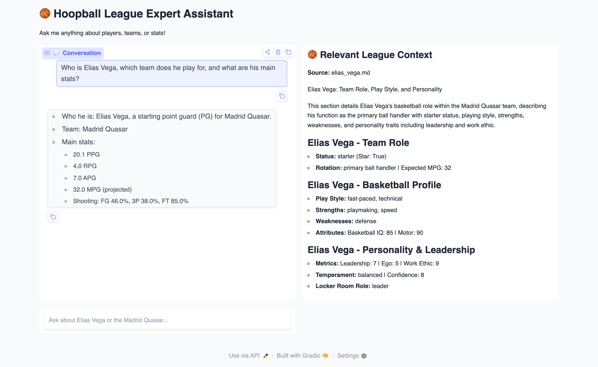
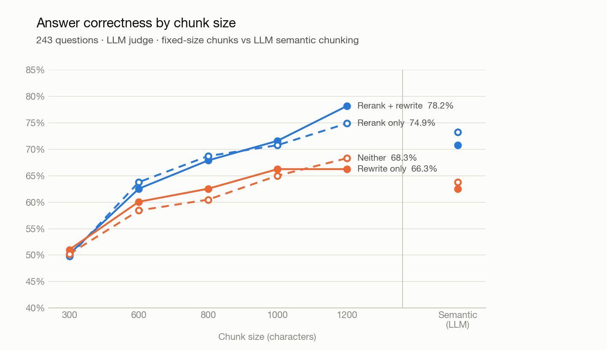
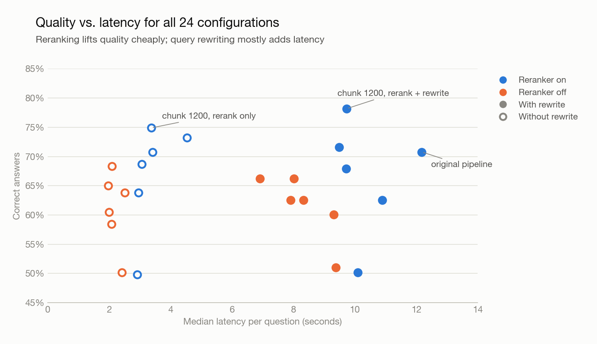

# AI-Powered NBA League RAG System

An end-to-end Retrieval-Augmented Generation (RAG) system designed to simulate, structure, and query a custom NBA-style league using Large Language Models (LLMs) and vector-based retrieval.

This project focuses on building a realistic AI-driven knowledge system and exploring advanced GenAI techniques such as query rewriting, reranking, and model selection strategies.

---

## Overview

The system generates a structured sports league (teams, players, contracts, championships) using LLMs, transforms it into a vectorized knowledge base, and enables natural language querying through a multi-stage RAG pipeline.

Beyond basic RAG, the project emphasizes **improving retrieval quality and response accuracy** through iterative experimentation.

---

## Key Features

- AI-generated structured league data (teams, players, contracts, etc.)
- Markdown-based knowledge representation
- Semantic search using vector embeddings
- Retrieval-Augmented Generation (RAG)
- Query rewriting for improved semantic matching
- Reranking of retrieved documents
- Automated evaluation harness with LLM-as-judge + 24-configuration ablation study
- Multi-model usage and selection (Grok + OpenAI + OpenRouter)

---

## System Architecture

### 1. Data Generation

- Leveraged multiple LLMs (Grok and OpenAI's GPT-4o-mini) to generate structured league content
- Designed prompts to produce consistent and structured outputs (teams, players, contracts)
- Stored generated data as Markdown documents

---

### 2. Data Processing

- Split documents into semantic chunks
- Converted each chunk into vector embeddings using:
  - `text-embedding-3-large`

---

### 3. Vector Database

- Stored embeddings in **Chroma**
- Enabled semantic similarity search over generated league data

---

### 4. Retrieval Pipeline

- Preserved the original user query
- Generated an additional optimized query (query rewriting)
- Performed retrieval using both queries to improve recall

---

### 5. Reranking Layer

- Retrieved chunks are reranked with a local cross-encoder (`BAAI/bge-reranker-v2-m3`), with an LLM-based reranker as an alternative
- Top 15 retrieved → top 7 passed to the generator
- Reduced noise from vector similarity search

---

### 6. Response Generation

- Selected top-ranked context
- Passed context + query to LLM (`gpt-5-nano`, low reasoning effort)
- Generated final natural language response

---

## RAG Flow

1. User submits a query  
2. Query rewriting generates an improved version  
3. Both queries are used for retrieval  
4. Relevant chunks are retrieved from Chroma  
5. Results are reranked  
6. Top context is selected  
7. LLM generates final response  

---

## Evaluation & Ablation Study

I built an automated evaluation harness ([evaluation/](evaluation/)) and ran a full ablation:
**6 chunking strategies × 4 pipeline variants = 24 configurations**, each run on the same
**243-question** test set ([rag_eval_nla.jsonl](evaluation/rag_eval_nla.jsonl)) covering direct facts,
comparisons, rankings, multi-hop and holistic questions.

**Pipeline variants**

| Variant | Query rewriting | Reranking |
|---|---|---|
| `rw_rr` | Yes | Yes |
| `rw_only` | Yes | No |
| `rr_only` | No | Yes |
| `none` | No | No |

**Chunking strategies:** LLM-based semantic chunking (`docs`) vs. fixed-size chunks of 300 / 600 / 800 / 1000 / 1200 characters.

**Metrics** — an LLM judge (Gemini 2.5 Flash-Lite) scores each answer for correctness and faithfulness to the
retrieved context, plus retrieval metrics (context recall, context sufficiency, MRR, precision@k),
latency and API cost. I hand-labelled a sample of answers ([calibration_labels.json](evaluation/calibration_labels.json))
to check the judge against human judgement before trusting it at scale.

### Results — all 24 configurations

Sorted by correctness. **Bold** = best in column. The original pipeline (semantic chunking + rewrite + rerank) is #5.

| # | Chunking | Rewrite | Rerank | Correct % | Faithful % | Ctx recall | MRR | p50 latency | Cost / 243 Qs |
|---|---|:---:|:---:|---|---|---|---|---|---|
| 1 | Fixed 1200 | Yes | Yes | **78.2** | **90.5** | **0.88** | **0.83** | 9.7s | $0.099 |
| 2 | Fixed 1200 | No | Yes | 74.9 | 90.1 | 0.85 | 0.81 | 3.4s | $0.040 |
| 3 | Semantic (LLM) | No | Yes | 73.3 | 87.7 | 0.83 | 0.79 | 4.5s | $0.047 |
| 4 | Fixed 1000 | Yes | Yes | 71.6 | 90.1 | 0.85 | **0.83** | 9.5s | $0.097 |
| 5 | Semantic (LLM) | Yes | Yes | 70.8 | 89.7 | 0.85 | 0.80 | 12.2s | $0.109 |
| 6 | Fixed 1000 | No | Yes | 70.8 | 87.2 | 0.83 | 0.81 | 3.4s | $0.037 |
| 7 | Fixed 800 | No | Yes | 68.7 | 86.8 | 0.79 | 0.80 | 3.1s | $0.031 |
| 8 | Fixed 1200 | No | No | 68.3 | 84.8 | 0.78 | 0.64 | 2.1s | $0.038 |
| 9 | Fixed 800 | Yes | Yes | 67.9 | 88.5 | 0.82 | 0.81 | 9.7s | $0.091 |
| 10 | Fixed 1000 | Yes | No | 66.3 | 84.8 | 0.77 | 0.63 | 8.0s | $0.096 |
| 11 | Fixed 1200 | Yes | No | 66.3 | 86.0 | 0.78 | 0.63 | 6.9s | $0.098 |
| 12 | Fixed 1000 | No | No | 65.0 | 86.8 | 0.76 | 0.64 | **2.0s** | $0.035 |
| 13 | Semantic (LLM) | No | No | 63.8 | 86.8 | 0.74 | 0.65 | 2.5s | $0.043 |
| 14 | Fixed 600 | No | Yes | 63.8 | 87.2 | 0.78 | 0.76 | 3.0s | $0.029 |
| 15 | Semantic (LLM) | Yes | No | 62.6 | 86.4 | 0.74 | 0.64 | 8.3s | $0.102 |
| 16 | Fixed 600 | Yes | Yes | 62.6 | 86.0 | 0.77 | 0.76 | 10.9s | $0.089 |
| 17 | Fixed 800 | Yes | No | 62.6 | 85.2 | 0.74 | 0.61 | 7.9s | $0.090 |
| 18 | Fixed 800 | No | No | 60.5 | 79.8 | 0.74 | 0.62 | 2.0s | $0.031 |
| 19 | Fixed 600 | Yes | No | 60.1 | 86.0 | 0.74 | 0.60 | 9.3s | $0.087 |
| 20 | Fixed 600 | No | No | 58.4 | 84.8 | 0.74 | 0.61 | 2.1s | $0.027 |
| 21 | Fixed 300 | Yes | No | 51.0 | 81.1 | 0.64 | 0.50 | 9.4s | $0.081 |
| 22 | Fixed 300 | Yes | Yes | 50.2 | 80.2 | 0.63 | 0.62 | 10.1s | $0.082 |
| 23 | Fixed 300 | No | No | 50.2 | 80.7 | 0.62 | 0.52 | 2.4s | **$0.022** |
| 24 | Fixed 300 | No | Yes | 49.8 | 82.7 | 0.63 | 0.62 | 2.9s | **$0.022** |

<picture>
  <source media="(prefers-color-scheme: dark)" srcset="docs/images/correctness_by_chunk_size_dark.png">
  
</picture>

<picture>
  <source media="(prefers-color-scheme: dark)" srcset="docs/images/quality_vs_latency_dark.png">
  
</picture>

Raw results (incl. faithfulness sub-scores, P@k, keyword coverage, judge cost): [evaluation/final_results/tables.txt](evaluation/final_results/tables.txt)
(per-category breakdown in [summary.json](evaluation/final_results/summary.json)).
Charts are generated by [plot_results.py](evaluation/plot_results.py).

### What I learned from the data

- **Reranking is the biggest single win.** Adding the cross-encoder reranker raised correctness by ~5–10 points
  at almost every chunk size and lifted MRR from ~0.63 to ~0.80.
- **Query rewriting adds little on top of reranking** — and costs ~2.5× the money and ~3× the latency.
  `cs1200 + rerank only` is the best quality-per-dollar setup.
- **Chunk size matters a lot.** Small chunks (300) lose ~20 points of correctness; larger chunks (1000–1200)
  performed best on this corpus.
- **Simple fixed-size chunking beat LLM semantic chunking** at 1200 characters, while being free to build.
- With 243 questions the noise is roughly ±3 points, so differences smaller than that are not treated as meaningful.

---

## Model Selection Strategy

- Used multiple LLMs (Grok, GPT-4o-mini) based on task requirements
- Evaluated models based on:
  - Output structure
  - Consistency
  - Relevance

### Selection Logic:
- **Data Generation** → Models optimized for creative structured output  
- **Answer Generation** → Models with stronger reasoning and response quality  

---

## Tech Stack

- **LLMs**: OpenAI (GPT-5-nano, GPT-4o-mini), Grok, Gemini 2.5 Flash-Lite (judge) via LiteLLM / OpenRouter  
- **Embeddings**: text-embedding-3-large  
- **Reranker**: BAAI/bge-reranker-v2-m3 (sentence-transformers cross-encoder)  
- **Vector Database**: Chroma  
- **Language**: Python  
- **Data Formats**: Markdown, JSONL  

---

## Key Learnings

- Measure before you optimize: the ablation showed reranking drives most of the gain, while query rewriting mostly adds cost and latency  
- Chunk size has a large effect on answer quality — test it rather than guess  
- An LLM judge needs to be calibrated against human labels before its scores are trusted  
- Reranking is critical to reduce noise from vector search  
- Prompt engineering directly impacts system reliability  
- Model selection should be task-specific, not one-size-fits-all  

---

## Limitations

- Limited historical depth in generated league data  
- Test set and corpus are synthetic; results may not transfer directly to real-world data  
- No persistent user personalization  

---

## Future Improvements

- Expand dataset with richer historical narratives and stats  
- Switch the default pipeline to the best ablation config (cs1200 + rerank)  
- Add personalization layer  
- Deploy as a web-based application  

---

## Why This Project Matters

This project demonstrates practical, hands-on experience in:

- Building end-to-end RAG systems  
- Working with LLM APIs in real-world scenarios  
- Improving GenAI systems through experimentation  
- Applying AI to structured domain problems  

---

## Contact

Feel free to explore, fork, or reach out!